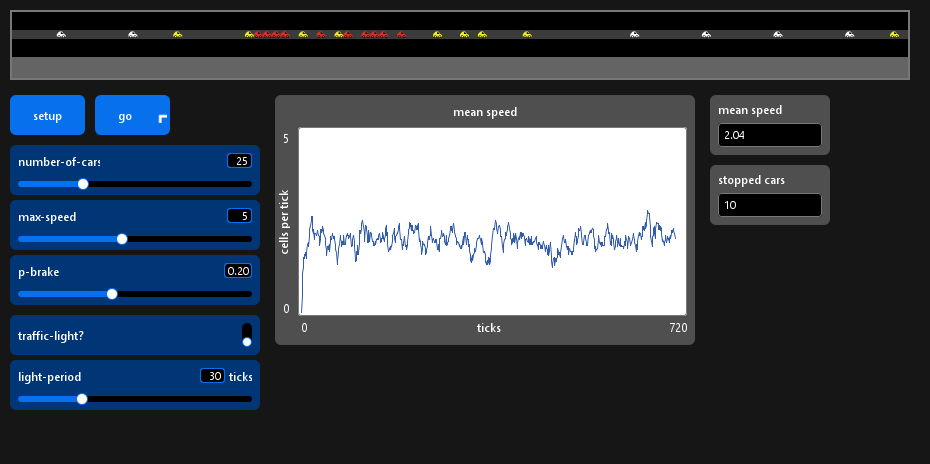
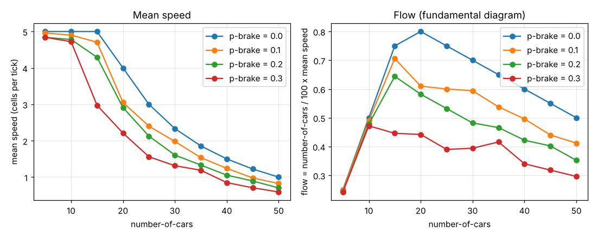

# Lab 1 — A city in motion (NetLogo)

Names: Ekaterina Popkova

## What I observed in the Models Library

- **Wolf Sheep Predation: values where both survive / both collapse.**
  1. *With the default parameters and `model-version` on `sheep-wolves` (no grass), press **setup**, then **go**. Who survives, and after how many ticks does the story end?*

     The wolves die out, the sheep survive and then grow without limit (no grass to stop them). In three timed runs the last wolf died at tick 249, 239 and 222; at that moment there were 328, 262 and only 3 sheep. After the last wolf dies the sheep grow without limit: in one run 2,660 sheep at tick 317 and 15,890 at tick 363.
  2. *Switch to `sheep-wolves-grass`. Find one set of slider values where **both species** are still alive after 1,000 ticks, and one where **both collapse**. Note the values.*

     Both survive: the default values (`grass-regrowth-time` 30, `initial-number-sheep` 100, `initial-number-wolves` 50, `sheep-gain-from-food` 4, `wolf-gain-from-food` 20, `sheep-reproduce` 4 %, `wolf-reproduce` 5 %). Sheep / wolves at tick 1000: 142 / 87.

     Both collapse: default values except `grass-regrowth-time` 100 and `sheep-gain-from-food` 1. Both populations are 0 at tick 36. With only `grass-regrowth-time` 100 the wolves are gone at tick 1000 and 10 sheep are left.
  3. *Run your "both survive" values three times. Does it always work?*

     3 out of 3 worked, but with different outcomes (sheep / wolves at tick 1000: 142 / 87, 210 / 46, 202 / 70). The model was hard to push into extinction: with `wolf-reproduce` 20 % it still survived (230 / 25), with `initial-number-wolves` 200 as well (183 / 91), and with `sheep-reproduce` 1 % the wolves died but the sheep survived (268 sheep).
- **Flocking: the table of the three -turn sliders.**

  300 birds, other sliders at their defaults, 600 ticks after **setup**.

  | Slider | Rule | What you see when it is 0 |
  | --- | --- | --- |
  | `max-separate-turn` | separation: steer away from a bird that is too close | Birds no longer avoid each other: flocks collapse into dense clumps with birds on top of each other. They still fly in the same direction. |
  | `max-align-turn` | alignment: steer towards the average heading of the neighbours | No flocks and no common direction: birds are spread over the whole view with random headings. |
  | `max-cohere-turn` | cohesion: steer towards the neighbours' average position | All birds fly in the same direction, but as one loose, wide band instead of tight flocks. |

  *Which of the three, alone, is enough to make birds fly in the same direction?* Alignment. With `max-separate-turn` and `max-cohere-turn` both at 0 and `max-align-turn` at 5, the birds still fly in the same direction after 600 ticks. With alignment at 0 and the other two rules on, they do not, so neither cohesion nor separation produces a common direction.
- **Segregation: the % similar table, and what happens above 75 %.**

  Density 95 %, one run per line; for 75 and 80 the monitors were read at tick 200 because **num-unhappy** never reached 0.

  | `%-similar-wanted` | % similar at the end | ticks needed |
  | --- | --- | --- |
  | 30 | 74.1 | 13 |
  | 50 | 86.6 | 20 |
  | 75 | 88.4 (453 households, 18.3 %, still unhappy) | not finished at 200 |
  | 80 | 51.7 (92.9 % unhappy) | not finished at 200 |

  *Something different happens above about 75 %: describe it.* The city stops settling. At 75 % there are big clusters, but households on their borders never all become happy and keep moving (in a longer run, still 291 unhappy at tick 578). At 80 % nearly everybody is unhappy all the time, nobody stays long enough to form a cluster, and % similar stays at about 52 %, which is what a random mix of two colours gives. So the most demanding population ends up the least segregated.

## Questions

1. **What is emergent in your traffic model? Name one property of the whole road that no rule of a single car mentions.** The phantom jam, and with it the mean speed and the flow of the whole road. No car rule mentions a jam, a queue or a wave. A cluster of stopped cars also moves *backwards* along the road while every car in it moves forwards: that is a property of the group, no car does it. The plot of `mean speed` is the same kind of thing: it settles around a value (about 2 for 25 cars and `p-brake` 0.2) that is written nowhere in the code.

2. **Which of the four rules causes the phantom jams? Give the experiment that shows it.** Rule 3, the random braking (dawdling), at densities below the point where the road is full anyway. With `p-brake` = 0 and up to 15 cars every run ends with mean speed exactly 5 (= `max-speed`): no jam. With the same 15 cars the mean is 4.71 at `p-brake` 0.1, 4.29 at 0.2 and 2.97 at 0.3: one random brake makes the car behind brake (rule 2), and the slowdown travels backwards. Experiment: same `number-of-cars`, only `p-brake` changes (`experiment.csv`, rows with 5–15 cars). Mean speed at tick 500, mean of 5 runs:

   | cars | `p-brake` 0 | 0.1 | 0.2 | 0.3 |
   | --- | --- | --- | --- | --- |
   | 5 | 5.00 | 4.96 | 4.84 | 4.84 |
   | 10 | 5.00 | 4.90 | 4.78 | 4.72 |
   | 15 | 5.00 | 4.71 | 4.29 | 2.97 |

3. **What changes with p-brake = 0? Answer for 10 cars and for 40 cars.**
   - 10 cars: mean speed 5.00 in all 5 BehaviorSpace runs, and in three more runs by hand (by hand = 500 ticks run in NetLogo, monitor read at the end; 0 stopped cars each time). With `p-brake` 0.2 it is 4.78 on average (by hand: 4.7, no stopped car at tick 500).
   - 40 cars: mean speed 1.50 in all 5 runs, and in three runs by hand (6–7 stopped cars). The road is saturated, so a jam still exists, but it is deterministic: the mean is exactly (1 − ρ) / ρ = 0.6 / 0.4. With `p-brake` 0.2 it falls to 1.06 on average (by hand: 1.08, 1.23, 0.98, with 14–18 stopped cars).
   - So with no randomness there is a sharp threshold: free flow up to 15 cars, a jam from 20 cars on (mean 4.00 at 20 cars, again (1 − ρ) / ρ).

4. **What does the traffic light cost in mean speed, at 10, 25 and 50 cars? When does it cost almost nothing, and why?** (`light-period` 30, `p-brake` 0.2, 500 ticks, three runs per cell, by hand with a loop in the Command Center.) Read as the lab sheet says, the **mean speed** monitor at tick 500 gives a misleading picture: the light turns red at ticks 0, 60, …, 480, so tick 500 falls inside a red phase and the queue is at its longest. So both that reading and the mean over ticks 100–500 are given.

   | cars | no light, monitor at 500 | with light, monitor at 500 | no light, mean over ticks 100–500 | with light, mean over ticks 100–500 | cost |
   | --- | --- | --- | --- | --- | --- |
   | 10 | 4.67 | 0.07 | 4.74 | 2.41 | −2.33 (−49 %) |
   | 25 | 1.99 | 0.43 | 2.04 | 1.12 | −0.92 (−45 %) |
   | 50 | 0.73 | 0.40 | 0.70 | 0.55 | −0.15 (−21 %) |

   To find when the light costs almost nothing, the same measurement (mean over ticks 100–500) was repeated for 10 to 90 cars in steps of 10, 5 runs per cell, without and with the light:

   | cars | no light | with light | cost | cost, % |
   | --- | --- | --- | --- | --- |
   | 10 | 4.76 | 2.34 | −2.42 | −51 % |
   | 20 | 2.64 | 1.38 | −1.26 | −48 % |
   | 30 | 1.57 | 0.91 | −0.66 | −42 % |
   | 40 | 1.04 | 0.69 | −0.35 | −34 % |
   | 50 | 0.71 | 0.55 | −0.16 | −23 % |
   | 60 | 0.49 | 0.42 | −0.07 | −14 % |
   | 70 | 0.32 | 0.28 | −0.04 | −13 % |
   | 80 | 0.19 | 0.17 | −0.017 | −9 % |
   | 90 | 0.086 | 0.082 | −0.004 | −5 % |

   The cost falls steadily with density. The light costs almost nothing at very high density, from about 70–80 cars: at 80 and 90 cars it takes only 0.017 and 0.004 cell per tick. Why: the road is jammed, the cars are already standing in queues, so a red light only changes where they stand, not how fast the road moves. At low density it is expensive: on a ring with a single light every car must pass it and it is red half of the time, so 10 cars lose about half of their speed. With the light the plot of `mean speed` oscillates with a period of about 60 ticks (2 × `light-period`), which is not the case without it.

5. **Why do you need repetitions, and how many did you need (section 5.3)?** Every run differs (`n-of` in `setup`, `random-float` in rule 3), so a single run is an anecdote. For 25 cars and `p-brake` 0.2 the standard deviation of the 5 final mean speeds is s = 0.288 and the uncertainty on the mean is s / √n, so s / √n < 0.05 needs n > (s / 0.05)² = 33.2, that is at least **34** repetitions. It is not the same for other densities: 10 cars (s = 0.13) need 7, 50 cars (s = 0.079) need 3. The variability is largest near the transition between free flow and jam (15–25 cars), where whether a jam forms at all depends on the random start. Note that s itself comes from only 5 runs, so these numbers are uncertain too.

## Fundamental diagram

Flow = `number-of-cars / 100 × mean speed`, from `experiment.csv`. The flow peaks at 20 cars (density 0.20) for `p-brake` = 0, with 0.80, and at 15 cars for `p-brake` 0.1 and 0.2 (0.71 and 0.64). With larger `p-brake` the peak is lower and moves to smaller density. For `p-brake` = 0.3 the best cell is 10 cars (0.47), but the 15-car cell (0.45) has a standard deviation of 0.59 on the mean speed, so the position of the peak cannot be read more finely than "between 10 and 15 cars". The plot, made with the notebook `fundamental-diagram.ipynb`, is in the Screenshots section below.

## Screenshots

The model running with the traffic light on (25 cars, `p-brake` 0.2), after 505 ticks, during a red phase: cars coloured by speed (red = stopped, yellow = slowed down, white = `max-speed`), the light is the red circle at cell 50 with the queue of stopped cars behind it, the mean speed plot oscillating with the light cycle, and the monitors.

The same model without the light (25 cars, `p-brake` 0.2), with a phantom jam (red cluster), after 704 ticks:

Mean speed and flow against density. This one was not taken from the screen: it is drawn by the notebook `fundamental-diagram.ipynb` (pandas + matplotlib) from `experiment.csv` and saved as `img/fundamental-diagram.png`:

