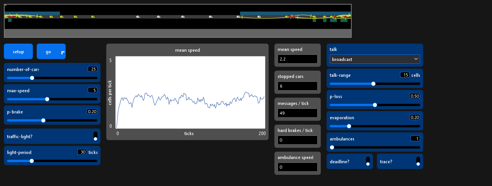
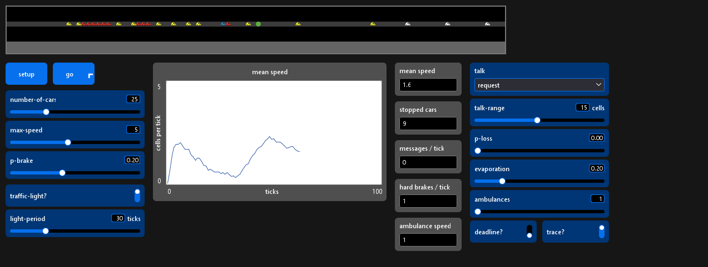
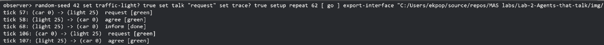
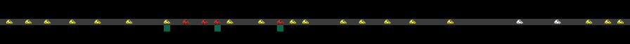
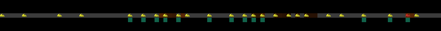
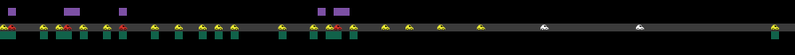
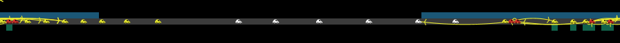
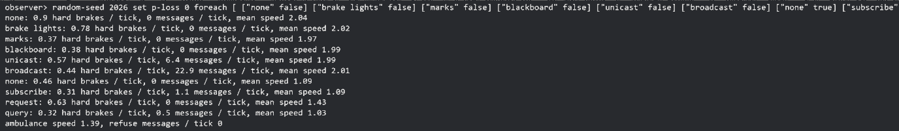

# Lab 2 — Agents that talk (NetLogo)

Names: Ekaterina Popkova

Files: `city-talks.nlogox` (the lab 1 model `../Lab-1-NetLogo/city-in-motion.nlogox`, extended as in sections 1–5 of the sheet, plus the three exercises of section 7), `results.csv` (section 6), `img/` (screenshots), `trace-request.txt` (the trace of question 6 as text).

With `talk` on `none` the model is lab 1 exactly: `measure 10` gives 0.88–0.90 hard brakes per tick and a mean speed of 2.01–2.04, as in the sheet.

Additions to the code of the sheet, all off by default, so that the rows of section 6 are the mechanisms of the sheet unchanged:

- `"query"` in the `talk` chooser (7.1): `query-light`, and a `query-ref` case in `light-handle`;
- `deadline?` switch and car variable `asked-at` (7.2): the ambulance asks again 3 ticks after an unanswered request; the light answers `agree` again to a repeated request from the ambulance it already holds green for;
- `ambulances` slider, 1–3 (7.3);
- `trace?` switch: the temporary trace of section 5.1, kept as a switch; it also prints `(lost)` for a message dropped by `p-loss`;
- `measure-ambulance [ runs ]`: like the one-line loop of section 5.2, plus the number of `refuse` messages per tick (global `refusals`).

## Results

Parameters: `number-of-cars` 25, `max-speed` 5, `p-brake` 0.2, `talk-range` 15, `evaporation` 0.2, `p-loss` 0, `light-period` 30. `measure 10` = 10 runs of 800 ticks, averaged over all ticks. NetLogo 7.0.4, commands typed in the Command Center, `random-seed 2026` before the series, so the table can be reproduced. In `results.csv` messages per tick have two decimals (`measure` prints one, which shows `request` as 0). The `query` row is from section 7, so it is in this table but not in `results.csv`.

| `talk` | light | who is addressed | hard brakes / tick | messages / tick | mean speed |
| --- | --- | --- | --- | --- | --- |
| `none` | off | nobody | 0.90 | 0 | 2.04 |
| `brake lights` | off | whoever looks | 0.78 | 0 | 2.02 |
| `marks` | off | whoever passes | 0.37 | 0 | 1.97 |
| `blackboard` | off | everybody | 0.38 | 0 | 1.99 |
| `unicast` | off | one car | 0.57 | 6.35 | 1.99 |
| `broadcast` | off | all in range | 0.44 | 22.93 | 2.01 |
| `none` | on | nobody | 0.46 | 0 | 1.09 |
| `subscribe` | on | the subscribers | 0.31 | 1.08 | 1.09 |
| `request` | on | the light | 0.63 | 0.04 | 1.43 (ambulance 1.45) |
| `query` (7.1) | on | the light | 0.32 | 0.5 | 1.03 |

All rows are close to the reference table of section 6. The only one that is not in it is the hard brakes of `request` (the sheet leaves it empty): 0.63, *more* than `none` with the light (0.46). A likely reason: the light held green for the ambulance makes everybody faster, and faster cars arriving at the next red light brake harder. The ambulance speed depends on which runs are averaged: 1.45 in the 10 runs of the table, 1.39 in the next 10 runs (`measure-ambulance 10`, last line of the screenshot at the end), 1.46 with 20 runs (section 7). A check with 40 runs (other seed) gives the same values within 0.01–0.04: `none` off 0.87 / 2.02, `marks` 0.36 / 1.96, `blackboard` 0.39 / 2.00, `none` on 0.46 / 1.10, `subscribe` 0.31 / 1.09, `query` 0.32 / 1.05.

### Lifetime of a mark (section 2.2)

`talk` on `marks`, 10 runs each. A mark starts at 1, is multiplied by (1 − `evaporation`) once per tick, after `tell` and before anybody reads it, and is read only above 0.3.

| `evaporation` | readable for | hard brakes / tick | mean speed |
| --- | --- | --- | --- |
| 0 | forever | 0.00 | 1.58 |
| 0.05 | 23 ticks | 0.14 | 1.70 |
| 0.1 | 11 ticks | 0.27 | 1.84 |
| 0.2 | 5 ticks | 0.36 | 1.96 |
| 0.4 | 2 ticks | 0.37 | 1.99 |
| 0.8 | never (1 → 0.2 before it is read) | 0.86 | 2.01 |
| 1 | never | 0.87 | 2.02 |

There is no single best lifetime, there is a trade-off. Long-lived marks remove almost all hard brakes, but they stay where there is no jam any more and slow everybody down: with `evaporation` 0 the whole road is marked after a while, every car is limited to speed 2, nobody can lose 3 in one tick, and the mean speed drops from 2.0 to 1.58. Between 0.2 and 0.4 (a mark readable for 2–5 ticks) the hard brakes are already divided by 2.4 and the mean speed is unchanged, so this is the best compromise. At 0.8 and above the mark is gone before anybody reads it: it is lab 1 again.

### Lost messages (section 3.4)

10 runs each.

| `p-loss` | `unicast` hard brakes | `unicast` messages | `broadcast` hard brakes | `broadcast` messages |
| --- | --- | --- | --- | --- |
| 0 | 0.54 | 6.3 | 0.41 | 24.6 |
| 0.25 | 0.64 | 6.2 | 0.47 | 25.0 |
| 0.5 | 0.72 | 5.9 | 0.57 | 27.5 |
| 0.75 | 0.79 | 5.8 | 0.71 | 27.3 |
| 1 | 0.92 | 5.7 | 0.88 | 30.5 |

More loss, less benefit, smoothly; at `p-loss` 1 both are back to the level without talking (0.92 and 0.88, against 0.87–0.90). Note the run-to-run noise of a 10-run measure: `broadcast` at `p-loss` 0 gives 0.41 / 24.6 here and 0.44 / 22.9 in the table above.

## Questions

1. **Which ways of communicating reduced the hard brakes the most, and what did each cost in messages per tick? Rank them by benefit per message.**

   Without the light, from 0.90 hard brakes per tick: marks 0.37 (−59 %) and the blackboard 0.38 (−58 %), for 0 messages; broadcast 0.44 (−51 %) for 22.9 messages; unicast 0.57 (−37 %) for 6.4 messages; brake lights 0.78 (−13 %) for 0 messages. With the light, from 0.46: subscribe 0.31 (−33 %) for 1.1 messages, query 0.32 (−30 %) for 0.5.

   Hard brakes avoided per message sent:

   | rank | `talk` | avoided / tick | messages / tick | avoided per message |
   | --- | --- | --- | --- | --- |
   | 1 | `marks`, `blackboard`, `brake lights` | 0.53, 0.52, 0.12 | 0 | no message at all |
   | 2 | `query` (light on) | 0.14 | 0.5 | 0.28 |
   | 3 | `subscribe` (light on) | 0.15 | 1.08 | 0.14 |
   | 4 | `unicast` | 0.33 | 6.35 | 0.052 |
   | 5 | `broadcast` | 0.46 | 22.93 | 0.020 |

   Broadcast avoids the most hard brakes of the four message-based ways, but it is the least efficient: unicast costs 2.6 times less per avoided hard brake. The zero-message ways are not free either: the blackboard is a central memory that every car reads at every tick (a server, a single point of failure), and marks need an environment that can store and erase information. `request` is not in the ranking: its goal is the ambulance speed, not the hard brakes.

2. **Brake lights barely help, marks help a lot. Both send zero messages: what is the difference in how far, and how long, the information travels?**

   *How far.* A brake light is read only by the next car, the one that looks at it, and only while it is within `talk-range`. When the next car is close, within 5 cells, it already *sees* the stopped car (rule 2), so the signal mostly repeats what perception gives. The news goes one car back, and the cars further behind learn nothing. A mark is read by *every* car that has it within 15 cells ahead, three times the perception distance, so it warns cars that cannot see the jam yet.

   *How long.* A brake light exists only while the car is stopped: it disappears as soon as the car moves on. A mark stays after the car has left, for about 5 ticks with `evaporation` 0.2 (table above). That is exactly what is needed, because a jam moves backwards: the mark is left at the place where the next cars will meet the jam. In short, a signal is the *current* state of one agent, and a mark is information stored in the environment, with its own lifetime and readable by anyone.

3. **The mean speed is about 2.0 in every row without a light. Why does talking make driving smoother but not faster?**

   Because what a car hears can only *lower* its speed (`advice` ≤ `max-speed`), never raise it above what rule 2 allows. The car arrives at the jam slower instead of braking from 5 to 0 at the last moment, but the jam is not shorter for that. On a single lane with no overtaking, the flow of the road is limited by how fast cars leave the head of the jam (rule 1 with random braking, rule 3), and no message changes that. The time a car saves by not stopping hard it spends driving slowly before the jam. When the advice is too cautious, driving becomes *slower*: marks that never fade give 0 hard brakes but a mean speed of 1.58. The only row where communication makes the road faster is `request`, because there the message changes the *environment* (the light stays green), not only the drivers.

4. **Unicast against broadcast: benefit, cost, robustness to p-loss. Why do lost messages never cause a crash in this model?**

   *Benefit:* broadcast is better (0.44 against 0.57 hard brakes per tick): a car that has just stopped warns every car within 15 cells at once, while with unicast the news goes back one car per tick. *Cost:* broadcast sends 3.6 times more messages (22.9 against 6.4), and many of them are useless (the cars ahead of the jam receive them too, as Figure 9 of the sheet shows). *Robustness:* with `p-loss` 0.5, unicast keeps 50 % of its benefit (0.72 against 0.54 at `p-loss` 0 and 0.90 without talking) and broadcast 67 % (0.57 against 0.41); at `p-loss` 0.75, 31 % and 39 %. Broadcast degrades a little more slowly because the same news reaches every car through several senders, while in unicast one lost message breaks the whole chain behind it. But broadcast pays for that redundancy in messages.

   *No crash:* a message only lowers `advice`, and rule 2 is applied *after* the advice, from perception: `if speed > free [ set speed free ]`. A lost message only means that the car drives as in lab 1, and lab 1 has no collisions. Safety never depends on communication here: messages are advice, perception is the guarantee.

5. **Why do the messages per tick of broadcast grow when p-loss grows?**

   Because `sent` is counted before the message is lost (`set sent sent + 1` is the first line of `send`), and a broadcast is sent when a car *just stopped*. The more messages are lost, the fewer cars are warned, so the more cars stop, and every stop is another broadcast to about 10 cars. Measured (10 runs each): 2.35 stops per tick at `p-loss` 0, 2.53 at 0.5 and 2.79 at 1, with 10.2–10.9 messages per stop. Unicast does the opposite: its messages fall slightly (6.3 → 5.7) because it is sent at every slowdown, and a car warned by the car ahead slows down in several small steps (each one a message), while without the warning it slows down once, hard (6.42 slowing cars per tick at `p-loss` 0, 5.78 at `p-loss` 1).

6. **Write the conversation you traced in section 5.1, tick by tick. What would happen if the agree were lost? (Exercise 2 of section 7 if you did it.)**

   `talk` on `request`, light on, `random-seed 42`, `setup repeat 120 [ go ]` with `trace?` on:

   ```
   tick 57: (car 0) -> (light 25)  request [green]
   tick 58: (light 25) -> (car 0)  agree [green]
   tick 68: (light 25) -> (car 0)  inform [done]
   tick 106: (car 0) -> (light 25)  request [green]
   tick 107: (light 25) -> (car 0)  agree [green]
   ```

   - Tick 57: the ambulance (car 0) comes within 15 cells of the light, sends `request`, state `"waiting"`.
   - Tick 58: the light reads it (one tick later), answers `agree`, turns or stays green, `hold?` true, and publishes its phase.
   - Ticks 58–68: the light holds green. The ambulance reads the `agree` in the same tick 58, because in `go` the light acts before the cars listen (state `"agreed"`), and passes.
   - Tick 68: the ambulance has passed the light (the light is no longer within 15 cells ahead of it, which is the test in `act-light`): `inform done`, the light returns to its cycle; the ambulance reads it in the same tick and goes back to `"idle"`.
   - Tick 106: next lap, the same conversation starts again.

   *If the agree is lost:* the light has already committed, so it holds green and the ambulance still passes on green; only the ambulance does not know it (it stays `"waiting"` until it passes the light and resets to `"idle"`). The dangerous loss is the `request` itself: then the light knows nothing and the ambulance waits for an answer that will never come, until it has passed the light. With `p-loss` 0.5 and `random-seed 3`, all three requests of the first 250 ticks were lost:

   ```
   tick 6: (car 17) -> (light 25)  request [green]   (lost)
   tick 76: (car 17) -> (light 25)  request [green]   (lost)
   tick 188: (car 17) -> (light 25)  request [green]   (lost)
   ```

   With the deadline of 7.2 (same seed), the ambulance asks again 3 ticks later, and the light, which already holds green for it, answers `agree` again:

   ```
   tick 94: (car 17) -> (light 25)  request [green]   (lost)
   tick 97: (car 17) -> (light 25)  request [green]
   tick 98: (light 25) -> (car 17)  agree [green]   (lost)
   tick 100: (car 17) -> (light 25)  request [green]
   tick 101: (light 25) -> (car 17)  agree [green]
   tick 104: (light 25) -> (car 17)  inform [done]   (lost)
   ```

   A lost `inform done` costs nothing: the ambulance resets itself once it is past the light.

7. **send drops a list in a mailbox; ask f [ set speed 0 ] would be shorter. Why does a multi-agent system not do that?**

   Because each agent controls its own state: that is what makes it an agent and not a function of somebody else. With `ask f [ set speed 0 ]`, car 0's code runs inside car 1 and decides for it. With `send`, car 1 receives information and decides itself what it means (here: lower its advice, and still check with its own perception). This matters for several reasons: (a) in a real system there is no shared memory, the cars are separate computers, and a message is the only thing that can travel between them; (b) a message can be late (here one tick) or lost (`p-loss`), and the model can show what that costs, which `ask` cannot; (c) the receiver can refuse, ignore or distrust a message (the light answers `refuse`), so no agent can break another one; (d) agents stay independent modules: a new kind of car only has to understand the messages, not expose its variables to everybody.

## Going further (section 7)

1. **Ask instead of waiting to be told.** Value `"query"` of `talk`: a car within `talk-range` before the light that has no `light-phase` yet sends one `query-ref`; the light answers with the same `inform` as `publish`; `follow-light-advice` is reused. Result (light on, 10 runs): 0.32 hard brakes per tick and **0.5 messages per tick**, against 0.31 and 1.08 for subscribe. Half the messages for almost the same benefit: a car asks once per approach (2 messages: `query-ref` + `inform`), while a subscriber costs `subscribe` + `inform` + `cancel` + one `inform` at every switch. The price: the answer is a snapshot. A car that asked during green does not learn that the light turned red, so it is not warned. The mean speed is a little lower with query (1.03–1.05 against 1.09, confirmed with 40 runs); I have not found why.

2. **A deadline.** `deadline?` on: a car variable `asked-at`; if the ambulance is still `"waiting"` 3 ticks after asking, it asks again. Light on, 20 runs each:

   | `p-loss` | `deadline?` | ambulance speed | messages / tick |
   | --- | --- | --- | --- |
   | 0 | off | 1.46 | 0.044 |
   | 0.5 | off | 1.25 | 0.026 |
   | 0.5 | on | 1.35 | 0.077 |

   The ambulance speed comes back partly (half of the loss). Not entirely, because the repeated requests can be lost too, and every retry costs 3 ticks of approach, at a range of 15 cells. Retrying every tick or from a longer distance would recover more, for more messages.

3. **Two ambulances.** `ambulances` 2 (and 3), `p-loss` 0, light on, 20 runs each:

   | ambulances | ambulance speed | messages / tick | `refuse` / tick |
   | --- | --- | --- | --- |
   | 1 | 1.46 | 0.044 | 0 |
   | 2 | 1.67 | 0.181 | 0.041 |
   | 3 | 1.79 | 0.394 | 0.122 |

   The refused ambulance sets its state to `"refused"` and asks again at the next tick, and again, until the light is free or it has passed the light: this polling is what multiplies the messages by 4 (2 ambulances) and 9 (3). The ambulances do not get slower, they get faster, and so does every car (mean speed 1.67 and 1.79), because the light is held green more often. On one lane there is no overtaking: the ambulance drives at the speed of the whole road (the slowest ambulance, 1.67, has the same speed as the mean). Fix: a queue of requests in the light. It answers the second ambulance with a single "queued" message (FIPA has no such performative, but `agree` with a condition, or `inform` of the position in the queue, would do), and serves it when the first has passed. That makes one message per ambulance instead of one per tick. A negotiation (the ambulances agree on an order) would need messages between the ambulances as well, so the queue in the light is the cheaper fix here, since the light is the only resource.

## Screenshots

All taken in NetLogo 7.0.4 with `city-talks.nlogox`, default sliders unless said otherwise; the images of the road were saved with `export-view` / `export-interface` from the Command Center.

`talk` on `broadcast`, `p-loss` 0.5, `random-seed 12`, after 200 ticks: yellow arcs (messages of this tick), blue bands (radio range of a car that just stopped), turquoise cells (cars that slowed down because of a message):



The ambulance and the light, `talk` on `request`, light on, `random-seed 42`, at tick 62: the blue ambulance is just before the light (green circle at cell 50), which holds green for it since tick 58; the red cars further back on the ring are a queue of stopped cars:



Its trace (`trace?` on), the conversation of question 6:



The road with each mechanism (`random-seed 12`, tick 150; `subscribe`: light on, `random-seed 4`, tick 115):

| `talk` | road |
| --- | --- |
| `brake lights` |  |
| `marks` (orange: the marks) |  |
| `blackboard` (violet, above the road: the notes) |  |
| `unicast` |  |
| `subscribe` (green arcs: subscriptions to the light) |  |
| `broadcast`, `p-loss` 0.5 (the road of the first screenshot) |  |

The measurements of section 6 in the Command Center (`random-seed 2026`), the lines of the table and of `results.csv` (the ambulance speed, 1.39, comes from 10 further runs, see above):


